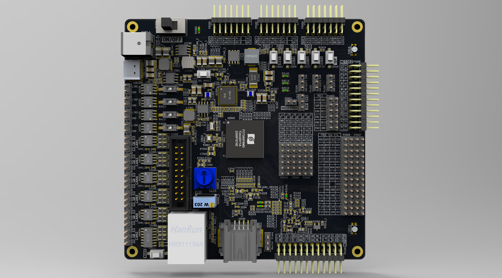

# Содержимое директории

Директория хранит справочную документацию (PDF/JPG) по ключевым компонентам системы.

## Карта файлов

| Файл | Компонент | Описание | Даташит / ссылка |
|---|---|---|---|
| [`sbc/ArmSoM-Sige7_1V1_20231218 Sch.pdf`](sbc/ArmSoM-Sige7_1V1_20231218%20Sch.pdf) | ArmSoM **Sige7** (RK3588) | Схема платы SBC v1.1 | [ArmSoM Sige7 — docs](https://docs.armsom.org/armsom-sige7) |
| [`sbc/armsom-sige5-1v3_Sch.pdf`](sbc/armsom-sige5-1v3_Sch.pdf) | ArmSoM **Sige5** (RK3588) | Схема платы SBC v1.3 (reference) | [ArmSoM Sige5 — docs](https://docs.armsom.org/armsom-sige5) |
| [`fc7300/FC7300_Demo_V1.0_Schematic_YT.pdf`](fc7300/FC7300_Demo_V1.0_Schematic_YT.pdf) | FC7300 Demo Board V1.0 | Схема демо-платы с 1000Base-T1 PHY YT8011A / RTL9010AA | [Flagchip (旗芯微)](https://www.flagchip.com.cn/en/) — даташит FC7300 доступен по запросу |
| [`fc7300/FC7300_Demo_Schematic_JL_V2.0.pdf`](fc7300/FC7300_Demo_Schematic_JL_V2.0.pdf) | FC7300 Demo Board V2.0 | Схема демо-платы с 1000Base-T1 PHY JL3113A + U3800 TD6810 | [Flagchip (旗芯微)](https://www.flagchip.com.cn/en/) |
| [`fc7300/FC7300_Demo_Board_3D_Top.jpg`](fc7300/FC7300_Demo_Board_3D_Top.jpg) | FC7300 Demo Board | 3D-рендер демо-платы (вид сверху) | — |
| [`can/TJA1043.pdf`](can/TJA1043.pdf) | NXP **TJA1043** | CAN FD transceiver (CAN2, U4400 на демо-плате) | [NXP TJA1043 datasheet](https://www.nxp.com/docs/en/data-sheet/TJA1043.pdf) · [product page](https://www.nxp.com/products/automotive-and-industrial-interfaces/can-interfaces/can-transceivers/high-speed-can-transceivers/tja1043) |
| [`eth/yt8011-1gbe-t1.pdf`](eth/yt8011-1gbe-t1.pdf) | NXP/Yutai **YT8011A** | 1000Base-T1 automotive PHY (U3100 на демо-плате V1.0) | [NXP YT8011A datasheet](https://www.nxp.com/docs/en/data-sheet/YT8011A.pdf) |
| [`rtc/PCF8563.pdf`](rtc/PCF8563.pdf) | NXP **PCF8563** | RTC/Calendar, I²C-bus | [NXP PCF8563 datasheet](https://www.nxp.com/docs/en/data-sheet/PCF8563.pdf) |
| [`hat/2-CH-CAN-FD-HAT-Rev2.1-Schematic.pdf`](hat/2-CH-CAN-FD-HAT-Rev2.1-Schematic.pdf) | Waveshare **2-CH CAN FD HAT** Rev2.1 | Схема изолированного 2-канального CAN FD HAT (MCP2518FD + TJA1043/TJA1057) | [Waveshare product page](https://www.waveshare.com/2-ch-can-fd-hat.htm) |

> Примечание: локальные PDF дублируют содержимое официальных даташитов (за исключением
> схем плат, которые публикуются только вендорами — ArmSoM, Flagchip, Waveshare).
> При изменении версий компонентов обновлять оба местa: локальный файл и ссылку в таблице.

## Схемы отладок FC7300

### Основные отличия схем FC7300 Demo V1.0 YT → V2.0 JL

| Узел | V1.0 YT | V2.0 JL | Главное отличие |
|---|---|---|---|
| 1000Base-T1 Ethernet PHY | U3100: RTL9010AA / YT8011A | U3700: JL3113A | Замена T1 PHY и изменение позиционного обозначения |
| Питание T1 PHY | Обвязка RTL/YT: VDD_REG, LX_OUT, AVDDH/L, DVDDL, SVDDL, VDDIO | Новые шины JL: AVDD1V8, AVDD3V3, DVDDIO, DVDD0V9; добавлен U3800: TD6810 | Для JL3113A нужен отдельный внешний DC-DC и низковольтные rails |
| Управление / strapping PHY | RXD2/MII_SEL, RXD3/MS_SEL, LED/PTP_GPIO/WAKE_O, DIS_N, WAKE, INH | RXD2/M_SEL0, RXD3/M_SEL1, TX_ENABLE/GPIO, WAKE_IN, INH, INT_N, RST_N | Изменена логика конфигурации и служебные выводы PHY |
| Дифференциальные линии T1 | TRP/TRN, TEST_P/TEST_N | MDI_P/MDI_N, TSTCLK_P/TSTCLK_N, SI_P/SI_N, SO_P/SO_N | Изменён набор Ethernet/T1 и тестовых пар |
| 1000Base-T RJ45 тракт | U3200: RTL8211FS-CG + J3200: HR911130A | Без изменений | RJ45/GigaT сторона сохранена |
| Ethernet MDIO/RGMII коммутация | BL1530TQFN / ETH_SW_SEL между 1000Tx и 1000T1 | BL1530TQFN / ETH_SW_SEL сохранён | Архитектура выбора MDIO не изменилась |
| Основные питание / периферия | MC33FS8530A1ESV, LN10543Q1, CH340C, CAN/LIN transceivers, EEPROM, NOR Flash | Без изменений | Ключевые IC вне Ethernet T1 остались прежними |

> ⚠️ **Предупреждение:** основное отличие — не пассивные обвесы, а замена 1000Base-T1 PHY на JL3113A с добавлением U3800 TD6810 и переработкой питания/управления PHY.

### 3D-модель платы отладки FC7300 (вид сверху)

- Файл: `FC7300_Demo_Board_3D_Top.jpg`
- Вид: верхний (Top), 3D-рендер демо-платы FC7300.
- На рендере видны основные узлы: процессор FC7300 (U2000), Ethernet PHY (U3100/U3200, U3700), CAN-трансиверы (U4300–U4550), разъёмы J1/J2 и обвязка питания (U7100–U7300).

### Список основных комплектующих V1.0 (только микросхемы и модули)

#### 1. Процессор
- FC7300, BGA320 — позиции: U2000A / U2000C

#### 2. Ethernet
- 1000Base-T1 PHY: RTL9010AA / YT8011A — позиция: U3100
- 1000Base-T PHY: RTL8211FS-CG — позиция: U3200
- RJ45-модуль с интегрированными магнитиками: HR911130A — позиция: J3200

#### 3. Системный контроллер питания / SBC
- MC33FS8530A1ESV — позиция: U1500

#### 4. DC-DC преобразователи
- LN10543Q1 — позиции: U7100, U7200, U7300; количество: 3 шт.

#### 5. USB-UART мост
- CH340C — позиция: U1400

#### 6. CAN-трансиверы
- TJA1043T — позиция: U4400; назначение: CAN2
- AZKN9125P — позиции: U4300, U4350, U4380; количество: 3 шт.; назначение: CAN1 / CAN4 / CAN6
- AZKN9145P / TJA1051T/3 — позиции: U4500, U4550; количество: 2 шт.; назначение: CAN3 / CAN5

#### 7. LIN-трансиверы
- TJA1021T/20 — позиции: U4100, U4150, U4200, U4250; количество: 4 шт.; назначение: LIN1–LIN4

#### 8. Память

### Основные отличия выбранных CAN-трансиверов

#### Сравнительная таблица

| Критерий | TJA1043T | AZKN9125P | AZKN9145P / TJA1051T/3 |
|---|---|---|---|
| Позиции на схеме | U4400 | U4300, U4350, U4380 | U4500, U4550 |
| Количество | 1 шт. | 3 шт. | 2 шт. |
| Назначение | CAN2 | CAN1 / CAN4 / CAN6 | CAN3 / CAN5 |
| Аналог / совместимость | NXP TJA1043T | Совместим с TJA1042T/3 | Совместим с TJA1051T/3 |
| Класс микросхемы | Высокофункциональный CAN-трансивер | Базовый высокоскоростной CAN-трансивер | Высокоскоростной CAN-трансивер с Silent mode |
| Основные сигнальные выводы | TXD, RXD, CANH, CANL | TXD, RXD, CANH, CANL | TXD, RXD, CANH, CANL |
| Дополнительные управляющие выводы | EN, STB_N, WAKE, INH, ERR_N, VBAT, SPLIT | STB | Silent |
| Поддержка CAN FD | Явно указана в схеме: HSCAN / CANFD / sleep | В явных заметках схемы не указана | В явных заметках схемы не указана |
| Управление сном / пробуждением | Есть отдельные WAKE, EN, STB_N, INH | Есть вывод STB | Нет отдельных WAKE / STB_N / INH в данной распиновке |
| Диагностика | Есть ERR_N | Нет отдельного diagnostic-вывода в распиновке | Нет отдельного diagnostic-вывода в распиновке |
| Termination / split | Есть SPLIT | Нет SPLIT | Нет SPLIT |
| Роль в плате | Наиболее “умный” CAN-канал, связан с общей логикой ETH_CAN_LIN_INH / wake | Простые CAN-каналы для основного обмена | CAN-каналы с акцентом на Silent mode |
| Ключевое отличие | Максимум служебных функций: wake, inhibit, error, split, CAN FD | Минимальная функциональность: основной CAN + STB | Отличие от AZKN9125P — вывод Silent вместо STB |

#### Краткий вывод

- **TJA1043T (U4400, CAN2)** — самый функциональный transceiver в этой группе: поддерживает **CAN FD**, имеет **WAKE / EN / STB_N / INH / ERR_N / SPLIT**.
- **AZKN9125P (U4300 / U4350 / U4380, CAN1 / CAN4 / CAN6)** — более простые CAN-трансиверы, совместимые с **TJA1042T/3**, с основным управлением через **STB**.
- **AZKN9145P / TJA1051T/3 (U4500 / U4550, CAN3 / CAN5)** — трансиверы, совместимые с **TJA1051T/3**, ключевое отличие — наличие вывода **Silent** вместо расширенных wake/inhibit/diagnostic функций.
- FM24C256EA1SO — EEPROM; позиция: U4600
- GD25Q32 — NOR Flash; позиция: U4700; варианты: GD25Q32CSIGR / GD25Q32ESIGR

### Сравнение Ethernet PHY: V1.0 YT vs V2.0 JL

| Параметр | V1.0 YT | V2.0 JL | Основное отличие |
|---|---|---|---|
| 1000Base-T1 PHY | RTL9010AA / YT8011A | JL3113 | Замена T1 PHY на решение Jinglue Semiconductor |
| 1000Base-T PHY | RTL8211FS-CG | RTL8211FS-CG | Без изменений |
| RJ45-модуль | HR911130A | HR911130A | Без изменений |
| Интерфейс к MCU | RGMII + MDIO | RGMII + MDIO | Тип интерфейса сохранён |
| Управление T1 PHY | MII_SEL, MS_SEL, LED/PTP_GPIO/WAKE_O, DIS_N, WAKE, INH | M_SEL0, M_SEL1, TX_ENABLE/GPIO, WAKE_IN, INH, INT_N, RST_N | Изменены strapping и служебные выводы |
| Питание T1 PHY | Шины под RTL/YT: AVDDH/L, DVDDL, SVDDL, VDDIO | Шины под JL3113: AVDD1V8, AVDD3V3, DVDDIO, DVDD0V9 | Переработана цепь питания T1 PHY |
| Тестовые / дифференциальные цепи T1 | TRP/TRN, TEST_P/TEST_N | MDI_P/MDI_N, TSTCLK_P/TSTCLK_N, SI_P/SI_N, SO_P/SO_N | Изменён набор пар и тестовых сигналов |
| Коммутация MDIO 1000Tx / 1000T1 | ETH_SW_SEL | ETH_SW_SEL | Архитектура выбора сохранена |

Ссылка на обзор: https://en.eeworld.com.cn/news/qcdz/eic670259.html

### Сравнительная таблица по PHY из статьи

| Партномер / семейство | Производитель | Стандарт / скорость | MAC–PHY интерфейс | Возможности PHY | Автомобильные функции / требования | Примечание |
|---|---|---|---|---|---|---|
| **YT8010A** | Yutai Micro | **100BASE-T1**, IEEE 802.3bw, 100 Мбит/с | В статье явно не детализирован | DSP, адаптивный эквалайзер, подавление эха, передача по одной витой паре | AEC-Q100 Grade 1 | 100M автомобильный Ethernet PHY, серийное производство |
| **YT8011A / YT8011A series** | Yutai Micro | **100BASE-T1 + 1000BASE-T1**, IEEE 802.3bw / 802.3bp, 100 Мбит/с / 1 Гбит/с | **RGMII** или **SGMII** | AFE, определение и коррекция полярности, адаптивная эквализация, подавление эха, восстановление синхронизации, коррекция ошибок, подавление перекрёстных помех | EEE, IEEE 1588, IEEE 802.1AS, SLEEP / WAKE, повышенная ESD и EMC стойкость | Gigabit автомобильный Ethernet PHY, серийное производство |
| **JL3xx1 / Cheetah series** | Jinglue Semiconductor | **100BASE-T1 + 1000BASE-T1**, IEEE 802.3bw / 802.3bp, 100 Мбит/с / 1 Гбит/с | В статье явно не указан | Однопроводный Gigabit Ethernet, дальняя передача по витой паре | AEC-Q100, диапазон температур -40℃ ~ +105℃, низкое энергопотребление, EMC / EMI / ESD | В демо-схеме V2.0 используется **JL3113** |

