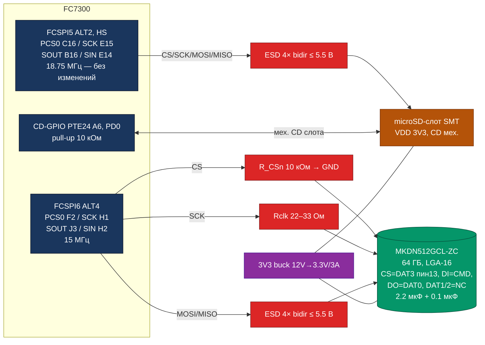

# microSD (FCSPI5) + SPI NAND 64 ГБ (MKDN512GCL-ZC) — одновременное подключение

Предложение по одновременному наличию на шилде **обоих** вариантов хранения, описанных
в [`sdcard.md`](sdcard.md): сменный слот **microSD** (вариант A из sdcard.md) и паянная
**SPI NAND 64 ГБ** (MKDN512GCL-ZC, вариант C из sdcard.md).

> **Целевой чип:** Flagchip **FC7300F8MDT2A320T1B** (BGA320). Пинаут — `FC7300F8MDT Pinout_V1.3.xlsx`.
> SD-часть (FCSPI5, слот, CD) — **без изменений** относительно sdcard.md.

## Вывод (TL;DR)

| Вариант | NAND-шина | Скорость NAND | Изоляция от слота | CS NAND | Standby | Оценка |
| :--- | :--- | :---: | :---: | :--- | :---: | :--- |
| **A. Отдельный FCSPI6 (ALT4)** | 4 сигнала: F2/H1/H2/J3 | 15 МГц → 1.875 МБ/с | ✅ полная | аппаратный PCS0 | ❌ (RUN) | ✅ **Рекомендуется** |
| B. Общая шина FCSPI5 + GPIO-CS | SCK/MOSI/MISO общие с картой | 18.75 МГц → 2.34 МБ/с | ❌ общая шина | GPIO (E9/PTE25) | ❌ (RUN) | компактный фолбэк |
| C. FCSPI0 (ALT4) + 2× PCS | SCK/MOSI/MISO = F5/C2/A2 | 18.75 МГц → 2.34 МБ/с | ❌ общая шина | аппаратный PCS1 (A6/PTE24) | ✅ | конфликтует с резервом FCSPI0 под Этап 2 |

**Рекомендация: вариант A.** SD-слот остаётся на FCSPI5 (как в sdcard.md), NAND
подключается к **отдельному контроллеру FCSPI6** — две независимые SPI-шины с
независимыми DMA: сгоревшая/некачественная карта в слоте не отключает NAND-буфер,
у каждого устройства — свой аппаратный CS, свои скорость и тайминги.

---

## 1. Ограничения (наследованы из sdcard.md)

- FC7300 **не имеет** контроллера SDMMC/SDIO/eMMC — SD-карта возможна только в **SPI-режиме**.
- OSPI занят конфликтом с RGMII (AN0001) — недоступен.
- Занято на шилде: RGMII+SMI, 8× FLEXCAN, UART1, I2C1, **FCSPI2 (NOR GD25Q32)**,
  SWD/JTAG, RESET_b, ISP_EN_B.
- FCSPI0 (HS pad: B1/F5/C2/A2) зарезервирован sdcard.md под **SPI-транспорт Этапа 2
  (FC7300 ↔ SBC)** — единственный FCSPI, работающий в Standby.
- Доступ к обоим хранилищам нужен в RUN mode; Standby — не требование (детект
  вставки карты в Standby обеспечивается CD-GPIO в домене PD0).

## 2. Факты по MKDN512GCL-ZC (SPI-режим) — критично для схемотехники

По даташиту (`hardware/pdf/nand/MKDN512GCL-ZC-C52753986.pdf`, §5 «Pin Assignments
(SD Mode & SPI Mode)», §6.2, §8, §10 «Reference Design»):

- 512 Gbit = **58984 МБ (64 ГБ)**, TLC, LGA-16 9×13 мм, шаг 1.27 мм;
  встроенный контроллер (ECC, wear leveling, bad-block mgmt), SD6.1.
- VDD = 3.3 В (2.7–3.6), I_чтение ≈ 55 мА, I_запись ≈ 60 мА (SD-режим, 4-wire),
  standby ≈ 90 мкА; T_op −25…+85 °C (коммерческий диапазон, не AEC-Q100).
- **Функции выводов в SPI-режиме (таблица §5):**

  | Вывод (SD-режим) | Функция в SPI-режиме | Подключение на шилде |
  | :--- | :--- | :--- |
  | **DAT3 (пин 13)** | **Chip Select (neg true)** | CS от FCSPI6_PCS0 + **pull-down 10 кОм к GND** |
  | **CMD** | **Data In (MOSI)** | FCSPI6_SOUT |
  | **DAT0** | **Data Out (MISO)** | FCSPI6_SIN |
  | CLK | Clock | FCSPI6_SCK + Rclk 22–33 Ом |
  | DAT1, DAT2 | Reserved | **NC** |
  | VDD | питание 3.3 В | шина 3V3, 2.2 мкФ + 0.1 мкФ |
  | GND | GND | GND |

- **Выбор режима при подаче питания (note c, §5; §6.2):** линия CD (т.е. DAT3/CS)
  имеет внутренний pull-up 50 кОм; **высокий уровень → SD-режим, низкий → SPI-режим**.
  Режим фиксируется в момент power-up и меняется только повторным CMD0 / power cycle.
  ⇒ **Обязателен внешний pull-down 10 кОм на линии CS**, чтобы при включении 3V3
  (когда FCSPI ещё не настроен) уровень был низким. Push-pull выход FCSPI6_PCS0
  впоследствии уверенно подтягивает CS вверх при деактивации.
- **Референс-дизайн (§10):** pull-up'ы RDAT/RCMD 10–100 кОм на DAT и CMD линиях,
  **2.2 мкФ на VDD**, Rclk 0–120 Ом в CLK.
- Максимальная частота SPI-режима в даташите не указана явно (208 МГц — SD-режим);
  15 МГц FCSPI6 — консервативно безопасно (проверить на образце, см. §9).

> ⚠️ **Корректировка sdcard.md §7:** там указано «CD (пин 1) подтянуть к GND».
> По таблице §5 даташита линия выбора режима — это **DAT3 = пин 13**, который в
> SPI-режиме и является chip select. Суть (pull-down 10 кОм) верна, пин — CS/DAT3.

## 3. Вариант A (рекомендуемый): NAND на отдельном FCSPI6

### 3.1 Пины

FCSPI6 (ALT4) — компактный кластер из 4 свободных ball'ов в углу BGA (ряды 1–3):

| Сигнал NAND | FCSPI6 | Ball | Pad | MUX | Домен |
| :--- | :--- | :---: | :--- | :---: | :--- |
| CS (active low) | FCSPI6_PCS0 | **F2** | PTI1 | ALT4 | PD1, Normal pad |
| SCK | FCSPI6_SCK | **H1** | PTF4 | ALT4 | PD1, Normal pad |
| MOSI (DI) | FCSPI6_SOUT | **J3** | PTF5 | ALT4 | PD1, Normal pad |
| MISO (DO) | FCSPI6_SIN | **H2** | PTF3 | ALT4 | PD1, Normal pad |

Normal pad → SCK ≤ **15 МГц** (Data Sheet, Table 32) → 1.875 МБ/с пик.
Конфликтов с текущим пинаутом шилда нет; альтернативный свободный набор FCSPI6 (ALT6):
U3/V1/P6/R5 — если кластер F2/H1/H2/J3 окажется занят в layout.
Фолбэк-инстанс: **FCSPI1 (ALT4)** — PCS0=G16/PTD23, SCK=D20/PTD2, SIN=H15/PTD3,
SOUT=G18/PTD4 (также все свободны, Normal pad).

### 3.2 Схема

### 3.3 Таблица соединений NAND

| Контакт LGA-16 | Подключение | Обвязка |
| :--- | :--- | :--- |
| VDD (2 шт.) | 3V3 | 2.2 мкФ X5R + 0.1 мкФ рядом с выводами |
| GND (4 шт.) | GND | GND-плоскость, короткие выводы |
| DAT3 (13) — CS | FCSPI6_PCS0 — F2 (PTI1) | **pull-down 10 кОм к GND** (выбор SPI-режима при power-up); ESD |
| CMD — DI | FCSPI6_SOUT — J3 (PTF5) | ESD; опц. pull-up 100 кОм (RCMD реф. дизайна) |
| DAT0 — DO | FCSPI6_SIN — H2 (PTF3) | ESD; опц. pull-up 100 кОм (RDAT) |
| CLK | FCSPI6_SCK — H1 (PTF4) | **Rclk 22–33 Ом** (реф. дизайн 0–120 Ом); ESD |
| DAT1, DAT2 | **NC** (Reserved в SPI) | — |

### 3.4 Правила реализации

1. **ESD:** 4-канальная двунаправленная матрица ≤ 5.5 В на CS/SCK/DI/DO — того же
   класса, что для слота (SM24CANB не подходит).
2. **Pull-down 10 кОм на CS — обязателен** (см. §2). В состоянии «карта выключена»
   расход ≈ 0.33 мА — пренебрежимо.
3. **Питание:** только с шины 3V3 (buck 12 V → 3.3 V / 3 A, см. `power.md`);
   последовательность — 3V3 → ≥ 1 мс → такт; при выключении сначала снять такт/CS
   (даташит §8.2.3: при power down линии DAT/CMD/CLK — обесточены или в лог. 0).
4. **Трассировка:** до чипа < 10 см, GND-плоскость под дорожками; Rclk у вывода чипа.
5. **FCSPI6:** master, WIDTH=1 (1-бит), SCK_PHA=0/SCK_POL=0 (mode 0), PRESCALE ≤ 15 МГц,
   PCS0 active low.
6. **Опционально — load switch на 3V3_NAND** (N-MOSFET с малым Rds(on), напр. BSS138,
   или SD3078/TPS2052B) с управлением от свободного GPIO (кандидат: **E9/PTE25, PD0**):
   шина NAND запитывается только после того, как прошивка выведет CS в лог. 0.
   Убирает единственное окно риска (неправильная latch-режим при включении 3V3)
   и позволяет «перезагрузить» режим без полного power cycle чипа.

### 3.5 Производительность (вариант A)

| Устройство | SCK | Пик | Реалистичный sustained |
| :--- | :---: | :---: | :---: |
| microSD (FCSPI5, HS) | 18.75 МГц | 2.34 МБ/с | 2.0–2.3 МБ/с |
| NAND 64 ГБ (FCSPI6) | 15 МГц | 1.875 МБ/с | 1.6–1.8 МБ/с |

Шины независимы — суммарная пропускная способность не ограничена общим SCK.
1.875 МБ/с покрывает автономный буферизованный лог (реальная утилизация 8× CAN FD
на порядок ниже пиковых 8 МБ/с), OTA-образы и экспорт; основное хранилище — eMMC/NVMe SBC.

## 4. Вариант B (компактный фолбэк): общая шина FCSPI5 + GPIO-CS для NAND

Если важно сэкономить 3 ball'а BGA и поднять NAND до 18.75 МГц:

- FCSPI5 — без изменений (C16/E15/B16/E14, HS pad, 18.75 МГц).
- microSD: CS = **FCSPI5_PCS0 (C16)** + pull-up 10 кОм (как в sdcard.md).
- NAND: CS = **GPIO E9/PTE25 (PD0)** + **pull-down 10 кОм** (тот же механизм выбора
  SPI-режима); SCK/MOSI/MISO — общие линии FCSPI5.
- Настройки FCSPI5: mode 0, 1-бит, 18.75 МГц (оба устройства допускают: SD ≤ 25 МГц,
  NAND ≥ 15 МГц — см. риск §9).

Минусы: (1) **нет изоляции** — замыкание/дефект карты в слоте уводит за собой MISO/MOSI/SCK
и NAND; (2) программный CS для NAND (cs-gpio) — в RT-Thread spi_dev поддерживается,
но при прерванном DMA-транзакции CS может остаться низким (нужен watchdog-сброс);
(3) один общий SCK — скорость фиксируется минимумом требований.

## 5. Вариант C (с оговоркой): FCSPI0, общая шина, 2× аппаратный PCS, Standby

FCSPI0 (ALT4, HS pad): SCK=F5/PTG23, SIN=C2/PTG22, SOUT=A2/PTF23,
CS_SD=PCS0 (B1/PTG21), **CS_NAND=PCS1 (A6/PTE24, PD0)**; 18.75 МГц на обоих устройствах;
FCSPI0 работает в Standby — доступ к обоим хранилищам даже в глубоком сне.
**Почему не основной вариант:** прямо противоречит sdcard.md (FCSPI0 зарезервирован под
SPI-транспорт Этапа 2 FC7300↔SBC), а A6/PTE24 уже занят в sdcard.md под CD-GPIO слота.
Рассматривать только если Этап 2 откажется от FCSPI0.

## 6. Программная часть (RT-Thread, SDK V2.6.0)

1. **Две SPI-шины** (вариант A):
   - `spi` bus 0 ← FCSPI5 (slot), устройство `spi_msd` → **/dev/msd0** (см. sdcard.md §6);
   - `spi` bus 1 ← FCSPI6 (NAND), устройство `spi_msd` → **/dev/msd1**.
2. **NAND в SPI-режиме протокольно — обычная SD-карта в SPI mode** (SD6.1),
   новый драйвер не нужен; стандартная инициализация:
   ≥ 74 такта idle (CS выключен) → CMD0 (0x40) → CMD8 (0x1AA) → ACMD41 (0x41, до сброса busy)
   → CMD58 → CMD9 (CSD) / CMD10 (CID). Выбор режима SPI сделан аппаратно (pull-down CS
   при power-up) — командно ничего дополнительного не требуется.
3. Конфигурация FCSPI6: master, 1-бит, mode 0, SCK ≤ 15 МГц, PCS0 active low
   (`Template/Driver/Source/module_driver_fcspi.c`, `HwA_fcspi.h`).
4. **Порядок старта:** CS low (GPIO/FCSPI6 инициализация до подачи 3V3_NAND при наличии
   load switch) → 3V3 ramp (0.1–35 мс) → ≥ 74 такта → инициализация.
5. Использование NAND: (a) fallback-буфер логов при недоступности SBC;
   (b) OTA-образы FC7300 (внутренний flash 8 МБ мало); (c) littlefs-том для данных прошивки.
   ECC/wear leveling — внутри чипа, хост видит блочное устройство 58984 МБ.
6. **Standby:** FCSPI5/FCSPI6 не работают в Standby (только FCSPI0) — доступ в RUN mode;
   детект карты — через CD-GPIO PTE24 (PD0), как в sdcard.md.

## 7. BOM — прирост (вариант A)

| Позиция | Кол-во | Примечание |
| :--- | :---: | :--- |
| MKDN512GCL-ZC (64 ГБ Nano SD NAND, LGA-16) | 1 | `hardware/pdf/nand/` |
| ESD-матрица 4× bidirectional, V_C ≤ 5.5 В | 1 | тот же компонент, что для слота |
| R 10 кОм (pull-down CS NAND) | 1 | **обязателен** |
| R 22–33 Ом (Rclk) | 1 | у вывода CLK чипа |
| R 100 кОм (RDAT/RCMD, опц.) | 2 | по реф. дизайну |
| C 2.2 мкФ X5R 3.3 В + 0.1 мкФ | 2 | VDD NAND |
| N-MOSFET BSS138 или load switch (опц.) | 1 | load switch 3V3_NAND |
| GPIO E9/PTE25 (опц., под load switch) | 1 | свободен, PD0 |
| Тестовые точки CS/SCK/DI/DO | 4 | диагностика |

Питание: +60 мА пиковых на шине 3V3 (в пределах бюджета buck 3 A).

## 8. Сравнение вариантов

| Критерий | A: FCSPI6 | B: FCSPI5+GPIO | C: FCSPI0 |
| :--- | :--- | :--- | :--- |
| Изменения в sdcard.md-дизайне | нет | нет | ломает (FCSPI0, A6) |
| Свободные ball'ы BGA | ✅ (F2/H1/H2/J3) | ✅✅ (1 GPIO) | ✅ (B1/F5/C2/A2 + A6) |
| Скорость NAND | 1.875 МБ/с | 2.34 МБ/с | 2.34 МБ/с |
| Аппаратный CS у обоих | ✅ | ❌ (GPIO) | ✅ |
| Изоляция от слота | ✅ | ❌ | ❌ |
| Независимые DMA | ✅ | ❌ | ❌ |
| Доступ в Standby | ❌ | ❌ | ✅ |
| Конфликт с Этапом 2 | нет | нет | **да** |
| Сложность прошивки | минимальная | средняя (cs-gpio) | минимальная |

## 9. Риски / проверить на образце

1. **Макс. такт NAND в SPI-режиме** не зафиксирован в даташите (208 МГц — SD-режим).
   15 МГц — консервативная оценка; прогнать stress-тест на 15 МГц, при запасе — поднять.
2. **Класс температуры:** −25…+85 °C (коммерческий, не AEC-Q100) — допустимо для
   подторпедного/кабинного размещения, не для подкапотного.
3. **Latch режима:** если по какой-то причине при power-up CS оказался высоким — NAND
   стартует в SD-режиме и не отвечает на SPI; лечение — power cycle (< 0.5 В, ≥ 1 мс).
   Load switch (§3.4 п.6) исключает этот сценарий.
4. **TLC-ресурс:** endurance ограничен (встроенный WL); для логгера при 1–2 МБ/с ресурс
   многократно превышает срок службы.
5. FCSPI5/FCSPI6 — домен PD1 (обесточиваются в Standby) — сознательный компромисс.

## Источники

- [`sdcard.md`](sdcard.md) — базовый дизайн слота (FCSPI5 ALT2, CD, ESD, прошивка).
- `hardware/pdf/nand/MKDN512GCL-ZC-C52753986.pdf` — §5 (таблица выводов SD/SPI mode,
  note c — выбор режима), §6.2 (инициализация), §6.3 (электрика), §8 (power scheme),
  §10 (reference design: RDAT/RCMD/Rclk/2.2 мкФ).
- `hardware/pinout/FC7300F8MDT Pinout_V1.3.xlsx` — FCSPI5/FCSPI6/FCSPI1/FCSPI0 MUX,
  ball'ы, pad-типы, домены PD0/PD1.
- `FC7300 Data Sheet_A4.pdf` Table 32 (SCK max: Normal 15 / HS 18.75 МГц).
- `FC7300 Reference Manual` гл. 55 (FCSPI: master/slave, PCS, mode 0, DMA).
- `power.md` — шина 3V3 (buck 12 V → 3.3 V / 3 A).
